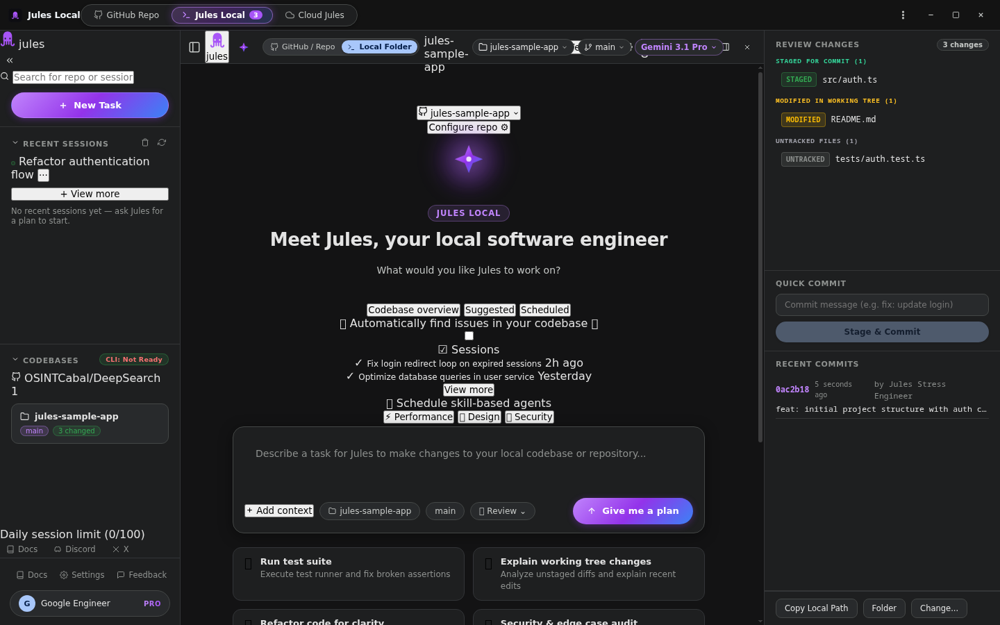
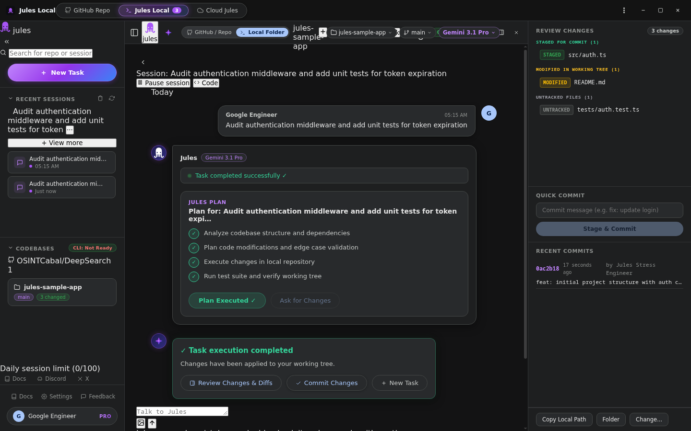

# JulesDeck

**Created by OSINTCabal**

Version **1.0.0**.

A Jules-style coding desktop app for **Fedora and Debian Linux**. Work with local Git repositories, plan changes, and run configured coding engines from one window.

[Install](docs/INSTALL.md) · [Development](docs/DEVELOPMENT.md) · [Verification](docs/VERIFICATION.md) · [Feature details](docs/PARITY.md)



These local workspace captures use disposable sample data, with no provider account connected.

## Features

Choose a local repository or a GitHub repository, create task branches, review plans, run a coding engine, and inspect the resulting changes. The desktop includes Git status, diffs, recent repositories, account switching, and GitHub publishing controls.

Select a configured engine and model in the composer or Settings. Supported routes include Gemini CLI, Codex, Claude Code, OpenCode, Aider, and the legacy Jules CLI. Each engine needs its own installed tool and authentication.

## How it works

1. **Local workspaces:** Git commands and coding processes run against the project you select. Plans, sessions, and workspace state are kept locally.
2. **GitHub repositories:** Git and the GitHub CLI provide discovery, managed clones, task branches, and pull request publishing. Publishing requires your GitHub authorization.
3. **Cloud workspace:** The optional embedded Jules page depends on Google's service availability. Local Git tools and configured engines are separate from that page.

## Installation

Fedora and Debian use **one repository and the same Electron installer**. Follow the [installation guide](docs/INSTALL.md) for system packages and optional coding tools, then run:

```bash
bash packaging/install.sh
julesdeck
```

Node **22.12 or newer**, npm, and Git are required. Debian 12's default Node version is older; install a supported Node version first. Close the app and finish active turns before reinstalling. Saved accounts and recent repositories are preserved.

The release verification targets are **Fedora 44 and Debian 13, x86-64**. See the [installation guide](docs/INSTALL.md) for dependencies.

## Screenshots

Plan and execution:



## Notes

- Your selected engine provides coding capability and usage allowance. Local storage does not mean model inference happens offline.
- GitHub CLI, provider tools, and the embedded cloud page have separate sign-ins.
- Cloud service availability is controlled upstream. This repository does not guarantee continued operation of that service.
- JulesDeck is unofficial and is not affiliated with Google. The source is released under the [MIT license](LICENSE).

## Coming soon

More packaging checks, coding integrations, and Linux desktop testing are planned.

## Deck series

[VibeDeck](https://github.com/OSINTCabal/VibeDeck) · [GrokDeck](https://github.com/OSINTCabal/GrokDeck) · [KimiDeck](https://github.com/OSINTCabal/KimiDeck) · [MinimaxDeck](https://github.com/OSINTCabal/MinimaxDeck) · [ManusDeck](https://github.com/OSINTCabal/ManusDeck) · [CopilotDeck](https://github.com/OSINTCabal/CopilotDeck) · [DeepDeck](https://github.com/OSINTCabal/DeepDeck) · [MuseDeck](https://github.com/OSINTCabal/MuseDeck) · [ReplitDeck](https://github.com/OSINTCabal/ReplitDeck) · [PerplexityDeck](https://github.com/OSINTCabal/PerplexityDeck)

Part of the OSINTCabal Deck series. [OSINTCabal.org](https://OSINTCabal.org).
